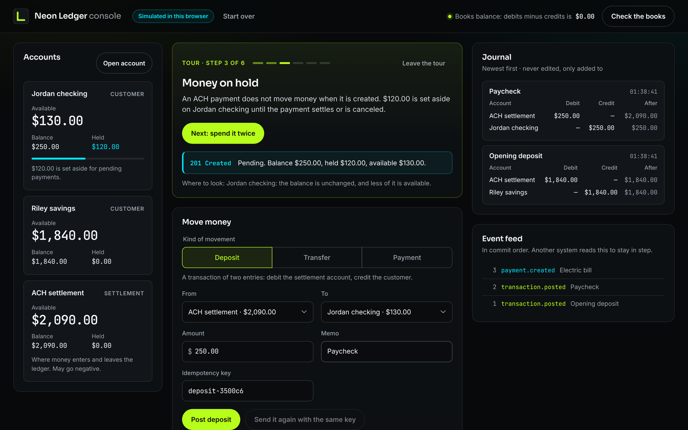

# Neon Ledger

A double-entry ledger for payment systems, as a small HTTP service: C# on .NET 10, EF Core, PostgreSQL.

It keeps accounts, the transactions between them, and payments that take time to settle and can come back. It is built around the things such a system has to get right:

- **Money is never created or destroyed.** Every transaction's debits equal its credits.
- **A retry never pays twice.** Writes carry an idempotency key, and a repeat returns the first response.
- **Two payments cannot spend the same money.** Concurrent writes against one account queue; they do not race. Funds promised to a pending payment are held and cannot be spent by anything else.
- **History is not edited.** Posted transactions are append-only, a mistake is corrected by posting a reversal, and a payment's status only moves forward.
- **Nothing happens silently.** Every change writes an event in the same database transaction, and the feed of those events cannot skip one.

I spent four years building payment and digital banking systems in C#. None of this code or design comes from an employer; it is written from scratch to show how I approach the problem.

## Status

Built: the ledger core, payments with two lifecycles (instant, and ACH-style pending → settled → returned), an event feed, and a browser console that runs against a simulation or against the service itself. Each is complete for what it claims below.

It is not a payments product. There is no authentication, and nothing here talks to a bank or a payment network: settlement and returns happen when a caller says so (see [Known limits](#known-limits) and [Roadmap](#roadmap)). It has not run in production.

## The console



A browser console for the ledger, in [`console/`](console/): move money, retry a request, hold funds, and try to break the books, with a six-step tour. It is published at **[ktodoran.github.io/neon-ledger](https://ktodoran.github.io/neon-ledger/)**.

It opens on a simulation of the ledger written in JavaScript, in the browser, so there is nothing to install to look at it. The simulation is a second implementation of the rules, not the ledger. Two things keep that honest:

- **It can be pointed at the real thing.** "Connect a real ledger" sends the same requests to a ledger running on your machine (see [Run it](#run-it)), and the tour and the three "try to break it" trials run against that, including a race between two real concurrent requests.
- **It is checked against the real thing.** One script of 35 requests is run against the simulation and against the real API, and CI fails if they answer differently in any status code, refusal code, message, balance or event.

To run the console yourself:

```bash
cd console
npm install
npm run dev      # http://localhost:5173, or add ?ledger=http://localhost:5080 to open it connected
```

## The rules, and where each one is enforced

The important rules are enforced twice: in the application, where a violation becomes a clear error, and in PostgreSQL, where it holds for every writer. The database tests write SQL directly, around the application, to prove the second layer on its own.

| Rule | Application | Database | Proved by |
|---|---|---|---|
| Debits equal credits | Validated before posting | Deferred constraint trigger, checked at commit | `DatabaseRuleTests`, `PostTransactionValidatorTests` |
| No overdraft on accounts that forbid it | Checked under a row lock | `CHECK (allow_negative OR balance - held >= 0)` | `PostingTests`, `ConcurrencyTests`, `DatabaseRuleTests` |
| Held funds cannot be spent twice | Postings and new holds are checked against the available balance, under the same row lock | The same `CHECK`, plus `held >= 0` | `PaymentTests`, `PaymentConcurrencyTests`, `DatabaseRuleTests` |
| No double spend under concurrency | `SELECT … FOR NO KEY UPDATE` on every account involved | Row locks | `ConcurrencyTests`, `PaymentConcurrencyTests` |
| No deadlock between opposing transfers | Payment row first, then accounts in id order | | `ConcurrencyTests` |
| A retry acts once | Idempotency key committed with the write | Primary key on the key | `IdempotencyTests`, `PaymentTests` |
| History is append-only | No update or delete paths exist | Triggers reject `UPDATE`, `DELETE`, `TRUNCATE` | `DatabaseRuleTests` |
| A transaction is reversed at most once | Checked under a lock on the original | Unique index | `ReversalTests` |
| A payment only moves forward, and its facts never change | Status checked under a lock on the payment row | Trigger on every update; `CHECK`s tie each status to its evidence | `PaymentTests`, `PaymentConcurrencyTests`, `DatabaseRuleTests` |
| Stored balances and holds match their sources | Changed in one database transaction with the entries or payment | | `IntegrityTests`, `HoldIntegrityTests` |
| The event feed never skips an event | Ordered by database transaction id, and held back while an older transaction is open | Events written in the same transaction as the change | `EventFeedTests` |

The concurrency tests were checked the hard way. Removing the lock ordering fails the opposing-transfers test; removing the account row lock fails the double-spend test; removing the payment row lock fails the settle-versus-cancel test; ignoring holds in the funds check fails the held-funds test; and dropping the transaction-id filter from the feed fails the out-of-order commit test.

## Run it

You need the [.NET 10 SDK](https://dotnet.microsoft.com/download) and Docker.

```bash
docker compose up -d --wait                          # PostgreSQL on localhost:5433
dotnet run --project src/NeonLedger.Api -- migrate   # create the schema
dotnet run --project src/NeonLedger.Api              # http://localhost:5080
```

If something on your machine already uses port 5433, pick another for both the database and the API before running the commands above:

```bash
export NEON_LEDGER_DB_PORT=5434
export ConnectionStrings__Ledger="Host=localhost;Port=5434;Database=neon_ledger;Username=ledger;Password=ledger"
```

The OpenAPI document is at `http://localhost:5080/openapi/v1.json`.

**Calling it from a web page.** A browser will only let a page call the service if the page's origin is listed under `Cors:AllowedOrigins`. In production configuration the list is empty. In development (`dotnet run`) it holds the console's addresses: `http://localhost:5173`, `http://localhost:4173` and `https://ktodoran.github.io`. To allow another, set `Cors__AllowedOrigins__0` and so on. The service has no authentication, so treat this list as the list of pages that may post to your ledger.

### A deposit, a retry and a refusal

Amounts are whole numbers of minor units: `25000` in USD is $250.00.

Open a settlement account (where money enters and leaves the ledger) and a customer account:

```bash
curl -s -X POST localhost:5080/v1/accounts -H 'Content-Type: application/json' \
  -d '{"name":"ACH settlement","currency":"USD","normalBalance":"debit","allowNegative":true}'

curl -s -X POST localhost:5080/v1/accounts -H 'Content-Type: application/json' \
  -d '{"name":"Jordan checking","currency":"USD","normalBalance":"credit"}'
```

Post a deposit, using the two ids from the responses:

```bash
curl -s -X POST localhost:5080/v1/transactions \
  -H 'Content-Type: application/json' -H 'Idempotency-Key: deposit-0001' \
  -d '{
    "description": "Incoming ACH deposit",
    "entries": [
      {"accountId": "<settlement id>", "direction": "debit",  "amount": 25000},
      {"accountId": "<customer id>",   "direction": "credit", "amount": 25000}
    ]
  }'
```

```json
{
  "id": "01a216ca-9ae9-7ede-89f1-0af132e48208",
  "description": "Incoming ACH deposit",
  "currency": "USD",
  "postedAt": "2026-11-26T07:38:26.409989+00:00",
  "reversesTransactionId": null,
  "entries": [
    {"id": 1, "accountId": "01a216ca-9807-…", "direction": "debit",  "amount": 25000, "balanceAfter": 25000},
    {"id": 2, "accountId": "01a216ca-993e-…", "direction": "credit", "amount": 25000, "balanceAfter": 25000}
  ]
}
```

Send the same request again and you get the same body back with an `Idempotent-Replayed: true` header. Nothing is posted a second time.

Try to move more than the customer has and the ledger refuses, with a `code` a client can branch on:

```json
{
  "type": "https://tools.ietf.org/html/rfc9110#section-15.5.21",
  "title": "Request refused",
  "status": 422,
  "detail": "Account 01a216ca-993e-… does not have enough funds for this transaction.",
  "code": "insufficient_funds"
}
```

### A bill payment that settles, then comes back

Create an ACH-style payment from the customer to the settlement account:

```bash
curl -s -X POST localhost:5080/v1/payments \
  -H 'Content-Type: application/json' -H 'Idempotency-Key: bill-0001' \
  -d '{"rail":"ach","sourceAccountId":"<customer id>","destinationAccountId":"<settlement id>","amount":12000,"description":"Electric bill"}'
```

It is `pending`. No money has moved, but the customer can no longer spend it:

```json
{"balance": 25000, "held": 12000, "available": 13000}
```

Settle it, and the hold becomes a posted transaction:

```bash
curl -s -X POST localhost:5080/v1/payments/<payment id>/settle -H 'Idempotency-Key: bill-0001-settle'
```

```json
{"balance": 13000, "held": 0, "available": 13000}
```

If it comes back, return it with the reason. The settlement is reversed, not erased:

```bash
curl -s -X POST localhost:5080/v1/payments/<payment id>/return \
  -H 'Content-Type: application/json' -H 'Idempotency-Key: bill-0001-return' -d '{"reason":"R01"}'
```

The whole story is in the event feed, in order:

```bash
curl -s 'localhost:5080/v1/events'
```

```
payment.created      transaction.posted   payment.settled
transaction.posted   payment.returned
```

## Payments

A payment moves an amount from a source account to a destination account. Between two customer accounts that is a transfer. From a customer to a settlement account it is an outgoing payment, and from a settlement account to a customer it is a deposit.

The rail decides when it is final:

| Rail | On create | Afterwards |
|---|---|---|
| `instant` | The money moves at once. Status is `settled`. | Nothing. It is final: it cannot be canceled or returned. |
| `ach` | Funds are held on the source. Status is `pending`. No money moves. | `settle` moves the money and lifts the hold. `cancel` lifts the hold. After settlement, `return` reverses it. |

```
            settle               return
 pending ───────────▶ settled ───────────▶ returned
    │
    │ cancel
    ▼
 canceled
```

An account has three numbers. `balance` is what has posted. `held` is the part of it promised to pending payments. `available` is the difference, and it is what every funds check uses, for postings and payments alike.

A return is refused if the money is no longer in the destination account. The payment then stays `settled`, because that is the truth.

## API

| Method and path | What it does |
|---|---|
| `POST /v1/accounts` | Open an account: `name`, `currency`, `normalBalance` (`debit` or `credit`), `allowNegative`. |
| `GET /v1/accounts?limit=&after=` | The accounts, oldest first. Pass `nextAfter` back as `after`. |
| `GET /v1/accounts/{id}` | The account with its `balance`, `held` and `available`. |
| `GET /v1/accounts/{id}/entries?limit=&before=` | The account's entries, newest first, each with the balance after it. Keyset pagination. |
| `POST /v1/transactions` | Post a transaction of two or more entries. Requires `Idempotency-Key`. |
| `GET /v1/transactions/{id}` | A transaction and its entries. |
| `POST /v1/transactions/{id}/reversal` | Post the mirror image of a transaction. Requires `Idempotency-Key`. |
| `POST /v1/payments` | Create a payment: `rail` (`instant` or `ach`), `sourceAccountId`, `destinationAccountId`, `amount`, `description`. Requires `Idempotency-Key`. |
| `GET /v1/payments/{id}` | A payment, its status and the ledger transactions behind it. |
| `POST /v1/payments/{id}/settle` | Settle a pending payment. Requires `Idempotency-Key`. |
| `POST /v1/payments/{id}/cancel` | Cancel a pending payment. Requires `Idempotency-Key`. |
| `POST /v1/payments/{id}/return` | Return a settled payment, with a `reason`. Requires `Idempotency-Key`. |
| `GET /v1/events?after=&limit=` | The event feed, oldest first. Pass `nextCursor` back as `after`. |
| `GET /v1/integrity` | Recompute every balance from the entries and every hold from the pending payments, and report any that disagree. |
| `GET /health` | Whether the service can reach its database. |

A transaction can have more than two entries, so one payment can carry its fee:

```json
{
  "description": "Bill payment with fee",
  "entries": [
    {"accountId": "<payer>",       "direction": "debit",  "amount": 5150},
    {"accountId": "<biller>",      "direction": "credit", "amount": 5000},
    {"accountId": "<fee revenue>", "direction": "credit", "amount": 150}
  ]
}
```

**Normal balance.** An account's balance grows on its normal side. Customer funds are a liability of the institution holding them, so customer accounts are credit-normal; cash and settlement accounts are debit-normal. That is why a deposit debits the settlement account and credits the customer, and both balances go up.

**Idempotency.** The key is stored with a hash of the request. The same key with the same request replays the stored response, success or refusal. The same key with a different request is refused (`idempotency_key_reused`). A request that fails validation never reaches the ledger and does not use up its key.

**Events.** `transaction.posted`, `payment.created`, `payment.settled`, `payment.canceled`, `payment.returned`. Each carries the transaction or payment in the same shape the API returns it.

**Errors.** Every error is an RFC 9457 problem document. Refusals carry a `code`: `insufficient_funds`, `account_not_found`, `currency_mismatch`, `already_reversed`, `reversal_not_reversible`, `transaction_not_found`, `payment_not_found`, `invalid_payment_state`, `idempotency_key_required`, `idempotency_key_too_long`, `idempotency_key_reused`, `validation_failed`.

## Design decisions

**Balances are stored, and the entries are still the truth.** Each account row carries its balance, updated in the same database transaction as the entries that change it, so reading a balance is one row. Each entry also records the balance after it, which gives a statement for free and makes any break in the chain visible. `GET /v1/integrity` recomputes everything from the entries and names the accounts that disagree.

**Pessimistic locks, taken in a fixed order.** A write locks every account it touches with `SELECT … FOR NO KEY UPDATE`, sorted by id, then checks funds and writes. Payments against one account are serialized by the database, and two transfers in opposite directions queue instead of deadlocking. Optimistic concurrency with retries would also work; I chose locks because a ledger's hot rows are contended by design, and under contention retries turn into wasted work and unpredictable latency. The lock mode matters: plain `FOR UPDATE` also blocks foreign-key checks, so a new pending payment that merely names a busy account as its destination would wait behind every settlement on it. A test holds that lock and checks the payment is still accepted.

**The idempotency key commits with the write.** The key row is inserted first, in the same database transaction as the write. A concurrent request with the same key blocks on the key's primary key until the first one commits, then reads its stored response. If the first one crashes, its transaction rolls back and takes the key with it, so the retry runs for real. There is no window where the money has moved and the key is not recorded, or the reverse.

**A hold is a number on the account, not a transfer to a clearing account.** The other common design moves pending funds into a shared clearing account and out again at settlement. That keeps everything as ledger entries, but it posts money that has not moved, and it puts every pending payment in the system through one row. Here a pending payment raises `held` on its own source account. The posted balance stays what a statement would show, the funds check is `balance - held`, and payments from different customers never wait on each other until they settle.

**A payment never touches a balance.** It places or releases a hold and asks the ledger to post. The ledger stays the only code that changes balances, and a payment is a small state machine on top of it, with its transitions guarded by a lock on the payment row.

**The event feed orders by database transaction, not by event id.** "Give me events with an id above the last one I saw" loses events: ids are assigned at insert, not at commit, so a slow transaction can commit a lower id after a reader has moved past it. The feed returns only events from transactions older than every transaction still in progress, and orders by transaction id. That set can no longer change, so a cursor never skips. The cost is that one long write transaction anywhere on the PostgreSQL server delays the feed until it finishes. Events are late, never lost.

**The database defends its own invariants.** The balanced-transaction rule, append-only history and the payment state machine are triggers and constraints written by hand in the migrations. An application bug, a script or a second service sharing the database cannot commit an unbalanced transaction, rewrite history or move a payment backward.

**EF Core, with SQL where it matters.** EF Core does the mapping, the migrations and the ordinary queries. The statements where the exact SQL is the point (the row locks, the idempotency insert, the event feed, the integrity check) are written out.

**One project, folders by concern.** `Domain`, `Ledger`, `Payments`, `Events`, `Idempotency`, `Data`, `Api`. It is a small service, and splitting it into several assemblies would add ceremony without adding a boundary anything depends on.

## Tests

```bash
dotnet test
```

Most tests drive the real application over HTTP, in process, against a real PostgreSQL. By default the run starts a throwaway PostgreSQL container, so Docker is the only requirement. To use a server you already have, set `NEON_LEDGER_TEST_POSTGRES` to a connection string for a user that may create databases. Each test class gets its own freshly migrated database.

CI runs formatting, a build with warnings as errors, and the tests on every push. The console has its own job: lint, formatting, its tests and a build. A third job starts the ledger and runs the console's parity script against it:

```bash
cd console && npm run parity    # needs the ledger running on localhost:5080
```

### Changing the schema

```bash
dotnet tool restore
dotnet ef migrations add <Name> --project src/NeonLedger.Api --output-dir Data/Migrations
```

The server never migrates on start. Apply migrations with `dotnet run --project src/NeonLedger.Api -- migrate`.

## Known limits

- **No authentication or authorization.** Anyone who can reach the service can post. It needs to sit behind something that authenticates callers until that is built.
- **Nothing settles by itself.** There are no effective dates, cutoffs, batches or files, and no connection to a bank or network. A caller decides when a payment settles or comes back. Return windows and return codes are not checked; the reason is stored as given.
- **A busy account is a queue.** Every write that touches an account waits for the one before it. That is correct for a customer account and a real ceiling for an account every settlement touches, such as a single settlement account. The usual answers are to shard such accounts or to batch their entries; neither is built.
- **A payment has one source, one destination and no fee.** A payment with a fee can be posted as a multi-entry transaction, but not yet as a payment with a lifecycle. There are no partial returns.
- **One currency per transaction.** There is no foreign exchange. Currency codes are checked for shape, not against the ISO 4217 list.
- **The event feed is pull-only**, and a long write transaction on the same PostgreSQL server delays it.
- **Idempotency keys are kept forever** and are global, not scoped to a caller. There is no expiry job.
- **The integrity check reads every entry.** It is an operational tool for a schedule, not something to call per request.

## Roadmap

1. **Caller authentication**, with idempotency keys scoped to the caller.
2. **Settlement that runs itself**: effective dates and a worker that settles what is due, in batches that touch the settlement account once.
3. **Webhooks** delivered from the event feed, with retries.

## License

MIT. See [LICENSE](LICENSE).
